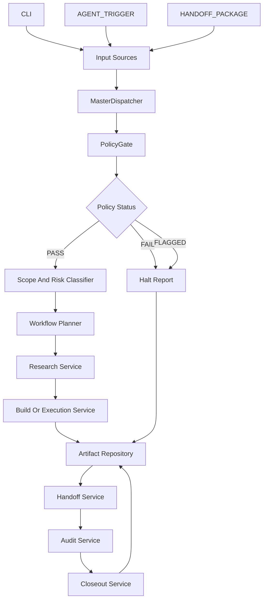

# ARCHITECTURE_REVIEW

## Purpose

This document defines the technical implementation order for the Fully Integrated Master Operating System inside `agencyos-one-bionic-codex-integration`.

The current project has a working scaffold, a source-aware `PolicyEngine`, and an `IntegrationOrchestrator` that halts blocked workflows before core services run. The next gap is the Master Dispatcher Logic: one authoritative coordinator that moves a request through policy, scope, research, build, handoff, audit, artifact storage, and closeout in a strict, testable order.

The development rule for this roadmap is:

```text
Every workflow path must pass through the same dispatcher.
Every dispatcher step must produce a traceable artifact or event.
Every risky condition must stop before external, destructive, sensitive, or irreversible action.
```

## A. Module Dependency Map



Dependency resolution order:

1. **Input Sources** depend on a stable request contract.
2. **MasterDispatcher** depends on `PolicyEngine` first and must call it before any other service.
3. **PolicyGate** depends on text context and source context.
4. **Scope And Risk Classifier** depends on a `PASS` policy result.
5. **Workflow Planner** depends on approved scope and risk.
6. **Research Service** depends on a planned workflow step.
7. **Build Or Execution Service** depends on research or scoped work data.
8. **Artifact Repository** depends on generated outputs, halt reports, audit records, and closeout records.
9. **Handoff Service** depends on artifact IDs and step completion status.
10. **Audit Service** depends on policy decisions, execution events, artifacts, and handoffs.
11. **Closeout Service** depends on audit status and artifact completeness.

Required module boundaries:

```text
src/dispatcher.py
  Owns the MasterDispatcher class and end-to-end workflow sequence.

src/orchestrator.py
  Keeps compatibility wrapper logic and delegates new workflow execution to MasterDispatcher.

src/policy_checker.py
  Owns PolicyEngine and returns PASS, FLAGGED, or FAIL decisions.

src/scope_classifier.py
  Converts policy-approved input into scope and risk metadata.

src/artifact_repo.py
  Writes artifacts, halt reports, audit records, and closeout packets.

src/handoff_service.py
  Creates handoff records between workflow stages.

src/audit_service.py
  Builds the trace of policy, scope, execution, artifact, and handoff events.

src/closeout_service.py
  Produces final workflow status and required next action.

tests/
  Proves each module in isolation and the full dispatcher sequence end to end.
```

## B. Implementation Roadmap (The Sprint Plan)

### Sprint 1: Define The Workflow Contract

Goal: Create one request and result contract that every source path uses.

Modules Affected:

```text
Create: src/contracts.py
Modify: tests/test_initial_scaffold.py
```

Task Type:

```text
Interface Definition (API Contract)
Test Write
Code Write
```

Measurable Output:

```text
WorkflowRequest and WorkflowResult dataclasses exist and serialize to dictionaries.
Tests confirm CLI, AGENT_TRIGGER, and HANDOFF_PACKAGE source contexts use the same shape.
```

Required interface:

```python
from dataclasses import dataclass, field


@dataclass
class WorkflowRequest:
    request_id: str
    input_context: str
    source_context: str = "CLI"
    metadata: dict = field(default_factory=dict)

    def to_dict(self) -> dict:
        return {
            "request_id": self.request_id,
            "input_context": self.input_context,
            "source_context": self.source_context,
            "metadata": self.metadata,
        }


@dataclass
class WorkflowResult:
    request_id: str
    status: str
    policy: dict
    events: list
    artifacts: list
    next_action: str

    def to_dict(self) -> dict:
        return {
            "request_id": self.request_id,
            "status": self.status,
            "policy": self.policy,
            "events": self.events,
            "artifacts": self.artifacts,
            "next_action": self.next_action,
        }
```

Acceptance Test:

```python
def test_workflow_request_contract_supports_all_sources():
    from contracts import WorkflowRequest

    for source in ["CLI", "AGENT_TRIGGER", "HANDOFF_PACKAGE"]:
        request = WorkflowRequest(
            request_id="req-test",
            input_context="Draft an internal runbook.",
            source_context=source,
        )

        assert request.to_dict()["source_context"] == source
        assert request.to_dict()["input_context"] == "Draft an internal runbook."
```

### Sprint 2: Extract MasterDispatcher

Goal: Create the single point of truth for all workflow execution.

Modules Affected:

```text
Create: src/dispatcher.py
Modify: src/orchestrator.py
Modify: tests/test_initial_scaffold.py
```

Task Type:

```text
Code Write
Test Write
Interface Definition (API Contract)
```

Measurable Output:

```text
MasterDispatcher.start_process() exists.
All requests call check_policy_pre() before any service execution.
Existing IntegrationOrchestrator.run_workflow() delegates to MasterDispatcher.
```

Critical Code Output Requirement:

```python
from policy_checker import PolicyEngine


class MasterDispatcher:
    """Single workflow authority for policy-first execution."""

    def __init__(self, policy_engine=None, services=None):
        self.policy_engine = policy_engine or PolicyEngine()
        self.services = services or {}
        self.events = []

    def start_process(self, request):
        policy = self.check_policy_pre(
            context=request.input_context,
            source=request.source_context,
        )

        if request.source_context == "AGENT_TRIGGER":
            self.events.append({
                "event": "INTERNAL_AGENT_REQUEST",
                "policy_enforced": True,
            })

        if policy["status"] in ("FLAGGED", "FAIL"):
            return self._halt(request=request, policy=policy)

        scoped = self.execute_step("scope_classifier", request.to_dict())
        planned = self.execute_step("workflow_planner", scoped)
        researched = self.execute_step("research_service", planned)
        built = self.execute_step("build_service", researched)
        artifact = self.execute_step("artifact_repo", built)
        handoff = self.execute_step("handoff_service", artifact)
        audit = self.execute_step("audit_service", handoff)
        closeout = self.execute_step("closeout_service", audit)

        return {
            "request_id": request.request_id,
            "status": "COMPLETED",
            "policy": policy,
            "events": list(self.events),
            "artifacts": [artifact],
            "next_action": closeout.get("next_action", "REVIEW_CLOSEOUT"),
        }

    def check_policy_pre(self, context, source="CLI"):
        return self.policy_engine.check_compliance(
            input_context=context,
            source=source,
        )

    def execute_step(self, service, data):
        if service not in self.services:
            raise KeyError(f"Missing dispatcher service: {service}")

        self.events.append({
            "event": "SERVICE_STARTED",
            "service": service,
        })

        result = self.services[service](data)

        self.events.append({
            "event": "SERVICE_COMPLETED",
            "service": service,
        })

        return result

    def _halt(self, request, policy):
        return {
            "request_id": request.request_id,
            "status": "HALTED",
            "policy": policy,
            "events": list(self.events),
            "artifacts": [],
            "next_action": policy["required_action"],
            "message": (
                "Workflow Halted by Policy Gate. "
                f"Reason: {policy['reason']}. "
                f"Required Action: {policy['required_action']}. "
                "Cannot proceed until resolved."
            ),
        }
```

Acceptance Test:

```python
def test_master_dispatcher_halts_before_services_on_policy_fail():
    from contracts import WorkflowRequest
    from dispatcher import MasterDispatcher

    executed = []

    def tracked_service(data):
        executed.append("service-ran")
        return data

    dispatcher = MasterDispatcher(
        services={"scope_classifier": tracked_service}
    )

    result = dispatcher.start_process(
        WorkflowRequest(
            request_id="req-policy-fail",
            input_context="Contact user@example.com about this request.",
        )
    )

    assert result["status"] == "HALTED"
    assert result["policy"]["reason"] == "PII_DETECTED"
    assert executed == []
```

### Sprint 3: Add Scope And Risk Classification

Goal: Convert approved input into explicit scope and risk metadata before planning.

Modules Affected:

```text
Create: src/scope_classifier.py
Modify: src/dispatcher.py
Modify: tests/test_initial_scaffold.py
```

Task Type:

```text
Code Write
Test Write
```

Measurable Output:

```text
Policy-approved requests produce scope, risk, allowed actions, and blocked actions.
High-risk language that passes basic policy can still route to human review when classifier rules require it.
```

Required interface:

```python
class ScopeClassifier:
    def classify(self, request_data: dict) -> dict:
        context = request_data["input_context"].lower()
        external = "send" in context or "publish" in context
        sensitive = "private" in context or "confidential" in context

        if external or sensitive:
            risk = "MEDIUM"
        else:
            risk = "LOW"

        return {
            **request_data,
            "scope": "internal_artifact",
            "risk": risk,
            "allowed_actions": ["PLAN", "DRAFT", "STORE_ARTIFACT"],
            "blocked_actions": ["EXTERNAL_SEND"] if external else [],
        }
```

Acceptance Test:

```python
def test_scope_classifier_blocks_external_send_action():
    from scope_classifier import ScopeClassifier

    result = ScopeClassifier().classify({
        "request_id": "req-external",
        "input_context": "Draft and send an external update.",
        "source_context": "CLI",
        "metadata": {},
    })

    assert result["risk"] == "MEDIUM"
    assert "EXTERNAL_SEND" in result["blocked_actions"]
```

### Sprint 4: Build Artifact Repository And Halt Reports

Goal: Persist every meaningful dispatcher result as a durable file.

Modules Affected:

```text
Create: src/artifact_repo.py
Modify: src/dispatcher.py
Modify: tests/test_initial_scaffold.py
```

Task Type:

```text
Code Write
Test Write
```

Measurable Output:

```text
Completed workflows write artifact JSON.
Halted workflows write halt report JSON.
Each file path is returned in the dispatcher result.
```

Required interface:

```python
import json
from pathlib import Path


class ArtifactRepository:
    def __init__(self, root_path):
        self.root_path = Path(root_path)
        self.root_path.mkdir(parents=True, exist_ok=True)

    def write_json(self, name: str, payload: dict) -> dict:
        safe_name = name.replace("/", "-").replace("\\", "-")
        path = self.root_path / f"{safe_name}.json"
        path.write_text(json.dumps(payload, indent=2), encoding="utf-8")
        return {
            "artifact_type": "json",
            "path": str(path),
            "name": safe_name,
        }
```

Acceptance Test:

```python
def test_artifact_repository_writes_halt_report(tmp_path):
    from artifact_repo import ArtifactRepository

    repo = ArtifactRepository(tmp_path)
    artifact = repo.write_json("halt-report", {"status": "HALTED"})

    assert artifact["name"] == "halt-report"
    assert (tmp_path / "halt-report.json").is_file()
```

### Sprint 5: Implement Handoff And Audit Services

Goal: Make service-to-service transitions explicit and reviewable.

Modules Affected:

```text
Create: src/handoff_service.py
Create: src/audit_service.py
Modify: src/dispatcher.py
Modify: tests/test_initial_scaffold.py
```

Task Type:

```text
Code Write
Test Write
```

Measurable Output:

```text
Each workflow creates a handoff record with source, destination, payload summary, and evidence status.
Each workflow creates an audit record with policy result, ordered service events, and artifact references.
```

Required interfaces:

```python
class HandoffService:
    def create_handoff(self, source: str, destination: str, payload: dict) -> dict:
        return {
            "source": source,
            "destination": destination,
            "status": "HANDOFF_CREATED",
            "evidence_status": "SUPPORTED",
            "payload_keys": sorted(payload.keys()),
        }


class AuditService:
    def create_audit(self, request_id: str, policy: dict, events: list, artifacts: list) -> dict:
        return {
            "request_id": request_id,
            "status": "AUDIT_CREATED",
            "policy_status": policy["status"],
            "event_count": len(events),
            "artifact_count": len(artifacts),
        }
```

Acceptance Test:

```python
def test_audit_service_records_policy_and_event_counts():
    from audit_service import AuditService

    audit = AuditService().create_audit(
        request_id="req-audit",
        policy={"status": "PASS"},
        events=[{"event": "SERVICE_STARTED"}],
        artifacts=[{"path": "artifact.json"}],
    )

    assert audit["status"] == "AUDIT_CREATED"
    assert audit["policy_status"] == "PASS"
    assert audit["event_count"] == 1
    assert audit["artifact_count"] == 1
```

### Sprint 6: Add Closeout And End-To-End Dispatcher Test

Goal: Prove the master operating loop works from request to closeout.

Modules Affected:

```text
Create: src/closeout_service.py
Modify: src/dispatcher.py
Modify: src/orchestrator.py
Modify: tests/test_initial_scaffold.py
```

Task Type:

```text
Code Write
Test Write
```

Measurable Output:

```text
A clean request completes with status COMPLETED.
A blocked request halts with no downstream service execution.
Both paths return next_action and artifact references.
```

Required interface:

```python
class CloseoutService:
    def close(self, audit_record: dict) -> dict:
        if audit_record["status"] != "AUDIT_CREATED":
            return {
                "status": "CLOSEOUT_BLOCKED",
                "next_action": "FIX_AUDIT",
            }

        return {
            "status": "CLOSED",
            "next_action": "READY_FOR_HUMAN_REVIEW",
        }
```

Acceptance Test:

```python
def test_master_dispatcher_completes_clean_request():
    from contracts import WorkflowRequest
    from dispatcher import MasterDispatcher

    def pass_through(data):
        return data

    services = {
        "scope_classifier": pass_through,
        "workflow_planner": pass_through,
        "research_service": pass_through,
        "build_service": pass_through,
        "artifact_repo": lambda data: {"path": "artifact.json", "data": data},
        "handoff_service": pass_through,
        "audit_service": lambda data: {"status": "AUDIT_CREATED"},
        "closeout_service": lambda data: {"status": "CLOSED", "next_action": "READY_FOR_HUMAN_REVIEW"},
    }

    result = MasterDispatcher(services=services).start_process(
        WorkflowRequest(
            request_id="req-clean",
            input_context="Draft an internal onboarding note.",
            source_context="CLI",
        )
    )

    assert result["status"] == "COMPLETED"
    assert result["next_action"] == "READY_FOR_HUMAN_REVIEW"
```

### Sprint 7: Connect Server Intake To MasterDispatcher

Goal: Replace direct model-and-file execution with policy-first dispatcher execution.

Modules Affected:

```text
Modify: ../../server.js
Create: src/server_contract.md
Modify: tests/test_initial_scaffold.py
```

Task Type:

```text
Interface Definition (API Contract)
Code Write
Test Write
```

Measurable Output:

```text
/api/new-project no longer sends content to model endpoints before dispatcher approval.
Server intake returns HALTED, FLAGGED, or ACCEPTED with policy reason and next action.
Client-controlled model endpoint is replaced by configured allowlisted endpoint.
```

Required server contract:

```json
{
  "request_id": "req-123",
  "source_context": "CLI",
  "input_context": "Draft an internal project brief.",
  "metadata": {
    "project_name": "agencyos-one-bionic-codex-integration",
    "client_name": "Internal"
  }
}
```

Required server response:

```json
{
  "success": true,
  "status": "ACCEPTED",
  "policy": {
    "status": "PASS",
    "reason": "NO_POLICY_VIOLATION",
    "required_action": "NONE"
  },
  "next_action": "READY_FOR_HUMAN_REVIEW",
  "artifacts": []
}
```

Acceptance Test:

```python
def test_server_contract_requires_policy_status():
    response = {
        "success": True,
        "status": "ACCEPTED",
        "policy": {
            "status": "PASS",
            "reason": "NO_POLICY_VIOLATION",
            "required_action": "NONE",
        },
        "next_action": "READY_FOR_HUMAN_REVIEW",
        "artifacts": [],
    }

    assert response["policy"]["status"] in ["PASS", "FLAGGED", "FAIL"]
    assert "next_action" in response
```

## C. Development Controls And Verification

The build should proceed in the sprint order above. Each sprint must use TDD:

```text
write failing test
run and confirm failure
write minimal implementation
run and confirm pass
review diff
commit or hand off for review
```

Global verification command for the integration project:

```text
python -m pytest tests/test_initial_scaffold.py
```

Root-level verification before connecting to broader AgencyOS Teams:

```text
python -m pytest -q
```

Known productization risks to handle during implementation:

1. Multiple governance paths exist in the broader repo. The dispatcher should become the integration project authority, then later reconcile with the root AgencyOS policy registry.
2. `server.js` currently calls LM Studio and writes files before a formal dispatcher approval. Sprint 7 must reverse that order.
3. External sends, sensitive content, paid commitments, governance changes, memory changes, and destructive operations must halt for human review.
4. AgencyOS Teams should remain the multi-project command center. AgencyOS One should remain the focused single-workflow product being operated or improved.

Final success definition:

```text
The Fully Integrated Master Operating System is ready for the next meeting when a single MasterDispatcher accepts a workflow request, checks policy first, executes approved services in order, writes artifacts, records handoffs, creates audit data, and closes with a human-readable next action.
```
